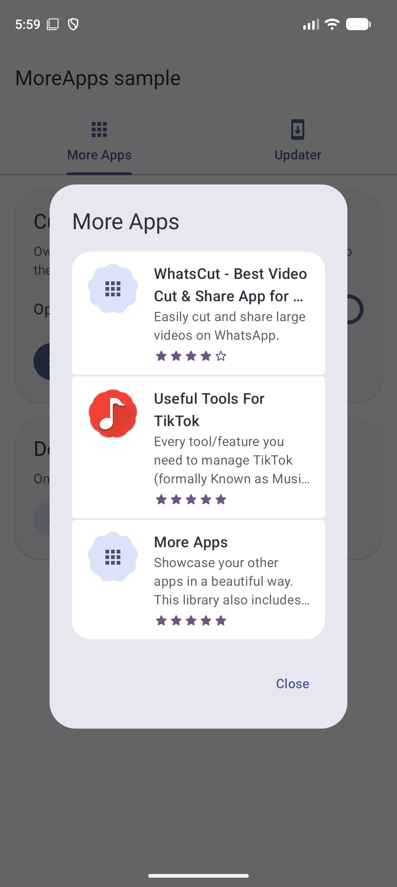

# MoreApps

[](https://central.sonatype.com/artifact/io.github.raghavsatyadev/moreapps)

Show your other apps in a Material 3 Expressive dialog, and prompt users to update (or move to a
new listing) from one JSON file you host anywhere.

Built with Compose Multiplatform for **Android** and **Desktop (JVM)**.



# Setup

Needs **minSdk 24** and Compose Multiplatform 1.13.

```kotlin
// build.gradle.kts
dependencies {
  implementation("io.github.raghavsatyadev:moreapps:3.0.0")
}
```

The library brings its own Ktor client, Coil and an isolated Koin graph, so it doesn't touch
your app's Koin setup or image loader.

# Initialize

**Android** (`Application.onCreate`):

```kotlin
MoreApps.initialize(this, JSON_URL)

// Optional: check in the background and post a notification when an update is out.
// Needs POST_NOTIFICATIONS on Android 13+ (ask for it in your activity).
MoreApps.schedulePeriodicCheck(this, smallIcon = R.drawable.ic_small_icon) // every 7 days
```

**Desktop** (`main`):

```kotlin
MoreApps.initialize(JSON_URL, packageName = "com.example.app", versionCode = 24)
```

# More Apps dialog

```kotlin
var show by remember { mutableStateOf(false) }
if (show) MoreAppsDialog(onDismiss = { show = false })
```

Every option:

```kotlin
MoreAppsDialog(
  onDismiss = { show = false },
  title = "Our other apps",                              // default "More Apps"
  hidePackages = setOf("com.appdroidtechnologies.whatscut"),
  openInStore = true,                                    // Play Store app instead of the browser
  onAppClick = { app -> analytics.log(app.packageName) },
)
```

Colors, shapes and type come from your `MaterialTheme` (use `MaterialExpressiveTheme` for the
expressive motion).

# Update prompts

Put this once near the root of your UI. On every start it shows whatever the JSON asks for:

```kotlin
UpdatePromptHost(onResult = { type -> /* e.g. hold the splash screen until this arrives */ })
```

Or drive it yourself:

```kotlin
val prompt = MoreApps.pendingPrompt()        // null when nothing is due
if (prompt != null) {
  MoreApps.markPromptShown(prompt)           // counts towards dialog_show_count
  // UpdateDialog(prompt, onDismiss = { ... })
}
MoreApps.dialogToShow()                      // the raw decision, ignoring show limits
```

Hard updates and hard redirects can't be dismissed and come back when the user returns without
updating.

# JSON format

Host a JSON array anywhere. The update fields are only needed for the update prompts; anything
missing falls back to a default.

```json
[
  {
    "image_link": "https://example.com/icon.png",
    "name": "More Apps",
    "rating": 4.5,
    "app_link": "https://play.google.com/store/apps/details?id=com.rocky.moreapps.example",
    "package_name": "com.rocky.moreapps.example",
    "description": "Showcase your other apps in a beautiful way.",
    "min_version": 14,
    "current_version": 15,
    "show_in_dialog": true,
    "redirect_details": {
      "enable": false,
      "hard_redirect": false,
      "dialog_title": "Redirect Notice",
      "dialog_message": "We have uploaded our app to a new location",
      "positive_button": "Redirect",
      "negative_button": "Cancel",
      "app_link": "https://play.google.com/store/apps/details?id=com.example.new"
    },
    "soft_update_details": {
      "enable": true,
      "dialog_show_count": 3,
      "notification_show_count": 3,
      "dialog_title": "Update available",
      "dialog_message": "A new version is out.",
      "positive_button": "Update",
      "negative_button": "Later"
    },
    "hard_update_details": {
      "enable": true,
      "dialog_title": "Update required",
      "dialog_message": "This version is no longer supported.",
      "positive_button": "Update"
    }
  }
]
```

| Field                                        | Meaning                                                                                            |
|----------------------------------------------|----------------------------------------------------------------------------------------------------|
| show_in_dialog                               | `false` leaves the app out of the More Apps dialog                                                 |
| min_version                                  | installed versions below this get the hard update prompt                                          |
| current_version                              | installed versions below this get the soft update prompt                                          |
| redirect_details                             | send users to a new listing (e.g. after the app was removed from the Play Store)                   |
| redirect_details->hard_redirect              | the user can't continue into the app                                                               |
| redirect_details->app_link                   | the new listing                                                                                    |
| soft_update_details->dialog_show_count       | how often the soft dialog shows per `current_version` (0 = every start); a new version resets it   |
| soft_update_details->notification_show_count | the same for the background notification                                                           |

Example file: [Resources/more_apps.json](Resources/more_apps.json)

# Migrating from 2.x

- `MoreAppsBuilder(...).buildAndShow(...)` → `MoreAppsDialog(onDismiss = ...)`.
- `ForceUpdater.showDialogLive(...)` → `UpdatePromptHost()`.
- `ForceUpdater.dialogToShow(context, app)` → `MoreApps.dialogToShow()`.
- `setPeriodicSettings(...)` → `MoreApps.schedulePeriodicCheck(...)`.
- Custom layouts, fonts and colors are gone: style it through your `MaterialTheme`.
- Remove the `WorkManagerInitializer` removal from your manifest and the
  `Configuration.Provider` from your `Application`; they are no longer needed.
- The soft-update dialog count carries over; the notification count starts again once.

# Sample

`sample/` holds the example app: `androidApp`, `desktopApp` and the shared `composeApp`.

```bash
./gradlew :sample:androidApp:installDebug
```

```bash
./gradlew :sample:desktopApp:run
```

# Licence

Copyright 2026 Raghav Satyadev

Licensed under the Apache License, Version 2.0 (the "License");
you may not use this file except in compliance with the License.
You may obtain a copy of the License at

       http://www.apache.org/licenses/LICENSE-2.0

Unless required by applicable law or agreed to in writing, software
distributed under the License is distributed on an "AS IS" BASIS,
WITHOUT WARRANTIES OR CONDITIONS OF ANY KIND, either express or implied.
See the License for the specific language governing permissions and
limitations under the License.
